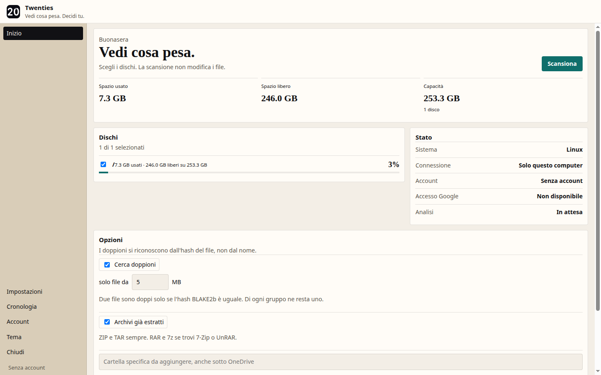
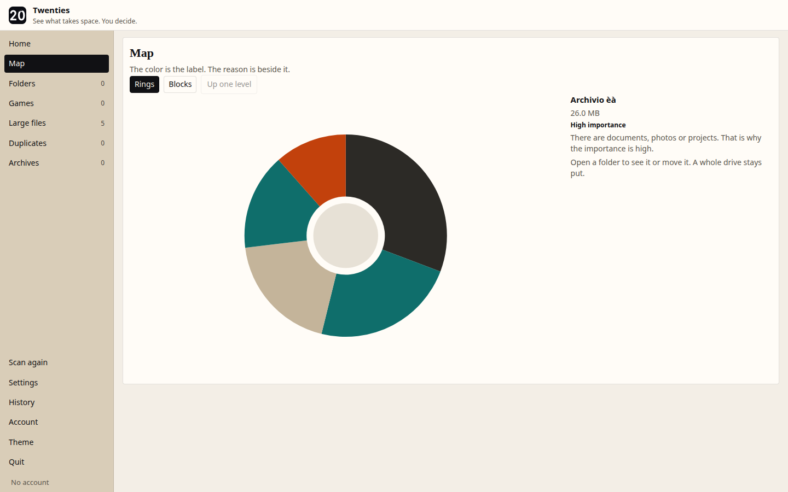

# Twenties

Vedi cosa pesa. Decidi tu.

Programma per Windows e macOS. Mostra cartelle, file grandi, giochi, doppioni e archivi già estratti, e dice perché. Sposta nel Cestino solo quello che confermi. Si usa anche senza account.





## Download

Versione 2.0.0: https://github.com/twoventi/twenties-cleaning/releases/latest

- Windows: `Twenties-Windows.exe`
- Mac (Intel e Apple Silicon, un file solo): `Twenties-macOS.dmg`

Se il job Mac non parte, su GitHub esce comunque il file Windows.

### Aprire il file

Windows, se compare «Windows ha protetto il PC»: Ulteriori informazioni → Esegui comunque.

Mac: tasto destro sull'app → Apri.

### Controllare SHA256SUMS

Accanto ai file c'è `SHA256SUMS`. Il numero deve coincidere.

```
# Windows, PowerShell
Get-FileHash .\Twenties-Windows.exe -Algorithm SHA256

# Mac
shasum -a 256 Twenties-macOS.dmg
```

## Avvio da sorgente

Serve Python 3.8 o più recente. Dettagli in [LEGGIMI.md](LEGGIMI.md).

```
pip install -r requirements.txt
python src/twenties_cleaning.py
```

Prova: `python tests/smoke_test.py`

## Per chi pubblica

```
python3 scripts/personalize.py --user TUO_UTENTE_GITHUB --repo twenties-cleaning --name "Nome Cognome" --email tua@email
```

Push su `main`, GitHub Pages da `main` / `docs`, poi un tag `v2.0.0`. La build pubblica Windows anche se il Mac non finisce.

Sito: https://twoventi.github.io/twenties-cleaning/

Licenza [MIT](LICENSE).

---

See what takes space. You decide.

Windows and macOS. It shows what takes space and why, and moves to the Trash only what you confirm. No account required.

Downloads are on the releases page: `Twenties-Windows.exe` and one `Twenties-macOS.dmg` for Intel and Apple Silicon. If the Mac build does not start, the Windows file is still published.

Windows, if you see “Windows protected your PC”: More info → Run anyway. Mac: right-click the app → Open. Check the file against `SHA256SUMS`.
